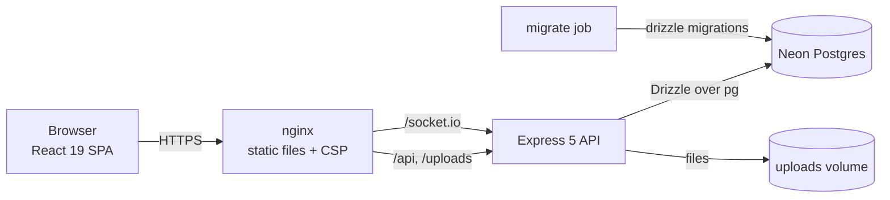

# Friendster Modern

A full-stack social network written end to end in TypeScript: posts with images, threaded replies, likes,
follows, real-time notifications and direct messages. Live demo: [friendster-social.netlify.app](https://friendster-social.netlify.app).


> A remake of a project I first built at university, rebuilt with the practices I use today.

<!-- Add a screenshot of the home feed at docs/screenshot.png, then replace this comment with:  -->

## Highlights

- **Auth that holds up**: short-lived access tokens, rotating refresh tokens in httpOnly cookies, reuse detection
  that revokes the whole session family, and rate limits on credential endpoints.
- **Correct under retries and concurrency**: idempotent post and message publishing (`clientId`), image claims and
  orphan sweeps that can never both win, durable file-deletion jobs with backoff.
- **Stable pagination**: keyset cursors (`created_at, id`) for feeds and messages, so new posts never shift or
  duplicate items while scrolling.
- **Real-time without drift**: Socket.io pushes updates; after a reconnect the client pages forward from its last
  known message and only marks messages read once the gap is filled.
- **Safe uploads**: signature sniffing, full decode and re-encode with sharp, pixel limits, metadata stripped.
- **Operable**: structured JSON logs (pino) with a request ID on every log line and error body, `/health` and
  `/ready` probes, graceful shutdown that drains traffic first, validated configuration at startup.
- **Hardened delivery**: non-root containers, CSP and security headers at the edge, least-privilege CI tokens,
  coverage thresholds, browser end-to-end tests against the real Docker stack, Dependabot.

## Architecture



| Layer | Choices | Why |
| --- | --- | --- |
| Web | React 19, Vite 7, Tailwind, Radix primitives, TanStack Query, Zustand | Server state in Query (cache, retries, infinite lists); a tiny store only for the session |
| API | Express 5, zod 4, Socket.io, multer + sharp, pino | Async errors handled natively by Express 5; every input parsed by zod at the edge |
| Data | Postgres on Neon, Drizzle ORM + drizzle-kit | Typed SQL with generated, reviewable migrations; constraints enforce integrity |
| Tests | Vitest + Supertest on PGlite (in-memory Postgres), Testing Library, Playwright | Real SQL semantics in unit-speed tests; browser tests cover the critical paths |
| Delivery | Docker, Compose profiles, GitHub Actions | One compose file for Neon or bundled Postgres; images tagged by commit SHA |

More detail in [ARCHITECTURE.md](ARCHITECTURE.md) and [DESIGN.md](DESIGN.md).

## Getting started

Requires Node.js 22.12+ (`nvm use` reads `.nvmrc`). Docker is optional.

### Local development

```bash
npm install
cp apps/api/.env.example apps/api/.env
cp apps/web/.env.example apps/web/.env
# Point DATABASE_URL in apps/api/.env at your Neon database, or start a local Postgres:
npm run db:dev
npm run dev            # API on :5000 (migrates first), web on :5173
```

### Full stack in Docker

```bash
cp .env.example .env   # fill in DATABASE_URL, both JWT secrets and CORS_ORIGIN
docker compose up -d --build                     # with Neon
docker compose --profile local-db up -d --build  # with bundled Postgres (also set POSTGRES_PASSWORD)
```

The site is served on http://localhost. nginx forwards `/api`, `/socket.io` and `/uploads` to the API, so it is
the only exposed port. A one-shot `migrate` container applies migrations (via `DATABASE_URL_DIRECT`) before the API
starts.

### Neon setup

1. Create a project at [neon.tech](https://neon.tech) and open **Connect**.
2. Use the **pooled** connection string (host contains `-pooler`) as `DATABASE_URL`.
3. Use the **direct** connection string as `DATABASE_URL_DIRECT` for migrations.

## Scripts

| Command | What it does |
| --- | --- |
| `npm run dev` | API and web in watch mode |
| `npm run typecheck` / `npm run lint` | TypeScript and ESLint (including jsx-a11y) for both apps |
| `npm test` | API integration tests and web unit tests |
| `npm run test:coverage -w @friendster/api` | API tests with coverage thresholds |
| `npm run test:e2e -w @friendster/web` | Playwright against a running stack (`E2E_BASE_URL`, default :5173) |
| `npm run build` | Production builds of both apps |
| `npm run db:generate -w @friendster/api` | Generate a migration after editing `schema.ts` |
| `npm run db:migrate -w @friendster/api` | Apply pending migrations |

## Testing strategy

- **API integration tests** run every route through Supertest against PGlite, a WASM build of Postgres, so
  constraints, transactions and full-text search behave as in production. CI fails below 70% line coverage.
- **Web tests** cover the realtime connection lifecycle, message catch-up after reconnects and the chat thread.
- **End-to-end tests** (Playwright) sign up, post, like, reply and sign back in against the production Docker
  images in CI.
- CI also checks that generated migrations match the schema and audits production dependencies.

## Configuration

The API validates its environment at startup and refuses to boot in production with a missing database URL,
missing or short JWT secrets, identical secrets, or no `CORS_ORIGIN`. See `apps/api/.env.example` and `.env.example`.

| Variable | Purpose |
| --- | --- |
| `DATABASE_URL` / `DATABASE_URL_DIRECT` | Pooled connection for the API, direct connection for migrations |
| `JWT_ACCESS_SECRET` / `JWT_REFRESH_SECRET` | Two different random values, 32+ characters (`openssl rand -hex 48`) |
| `CORS_ORIGIN` | Comma-separated list of site origins allowed to call the API |
| `LOG_LEVEL` | `debug` in development, `info` in production by default |
| `VITE_API_URL` | Web build only; omit for same-origin `/api` (the Docker setup) |

## Deployment

The CD workflow is opt-in: set the repository variable `DOCKER_PUBLISH=true` and the secrets `DOCKER_USERNAME` /
`DOCKER_PASSWORD`. After CI passes on a push to `main`, it publishes both images tagged with the commit SHA. To run
them: `IMAGE_PREFIX=<user> IMAGE_TAG=<sha> docker compose pull && docker compose up -d --no-build`.

Before going live: terminate TLS in front of nginx (then add HSTS), back up the `api_uploads` volume, and send logs
to your aggregator of choice.

## Known trade-offs

- Uploaded images live on a local volume, which limits the API to one instance. Object storage plus a Socket.io
  Redis adapter would remove that limit.
- Controllers talk to Drizzle directly rather than through a repository layer; with one database and typed queries,
  the extra indirection was not worth it at this size.
- The UI is dark-only by design.

## License

[MIT](LICENSE)
